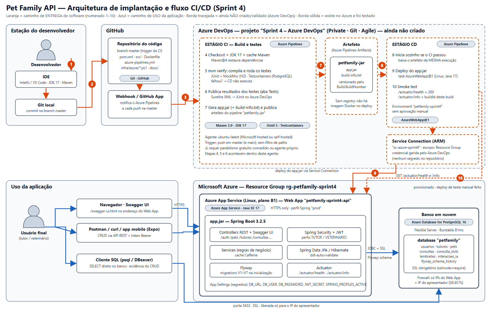

# Pet Family API: Sprint 4 · DevOps Tools & Cloud Computing

> **FIAP · Turma 2TDSPG** · Pipeline CI/CD no **Azure DevOps**, deploy automático em **Azure Web App** e banco **PostgreSQL** em nuvem.
> A aplicação (API REST em Java 17 + Spring Boot) já existia; esta entrega adiciona a esteira de DevOps e a infraestrutura na nuvem.

## Integrantes

| Nome | RM | Turma |
|---|---|---|
| Felipe Kirschner Modesto | RM561810 | 2TDSPG |
| João Victor Luiz de Oliveira Resende | RM565139 | 2TDSPG |
| Pedro Henrique Vaz Ferreira | RM566551 | 2TDSPG |
| Vitor Dias dos Santos | RM565422 | 2TDSPG |

## Links da entrega

| Item | Link |
|---|---|
| Repositório GitHub | [PET-FAMILYY/PET-FAMILY-NUVEM](https://github.com/PET-FAMILYY/PET-FAMILY-NUVEM) (branch `master`) |
| Projeto Azure DevOps | [Sprint 4 – Azure DevOps](https://dev.azure.com/petfamily-sprint4/Sprint%204%20%E2%80%93%20Azure%20DevOps) |
| Pipelines (CI/CD) | [Execuções](https://dev.azure.com/petfamily-sprint4/Sprint%204%20%E2%80%93%20Azure%20DevOps/_build) |
| Vídeo (YouTube) | [Sprint 4 – Pet Family API: CI/CD com Azure DevOps e Deploy no Azure Web App](https://youtu.be/n4meoXQD6jI) |

---

## Descrição da solução

**Problema.** Tutores de pets perdem a continuidade do cuidado veterinário: esquecem vacinas, perdem o histórico de consultas e não recebem lembretes preventivos.

**Solução.** A **Pet Family API** centraliza a saúde e o bem-estar dos pets. É uma API REST com autenticação por token (JWT) e dois perfis, **TUTOR** e **VETERINARIO**. Ela oferece:

- cadastro de tutores e de vários pets por tutor, com dados clínicos;
- agendamento, cancelamento e atendimento de consultas, com controle de disponibilidade;
- cuidados preventivos com recorrência automática;
- linha do tempo unificada do pet, assistente de IA simulado e dashboard clínico.

**Nesta Sprint** a aplicação passou a ser entregue por uma esteira de **CI/CD no Azure DevOps**, publicada em um **Azure Web App** e ligada a um **PostgreSQL gerenciado na nuvem**.

### Stack de tecnologias

| Camada | Tecnologia |
|---|---|
| Aplicação | Java 17, Spring Boot 3.2.5, Spring Web, Spring Data JPA (Hibernate), Bean Validation |
| Segurança | Spring Security + JWT (jjwt), perfis TUTOR e VETERINARIO |
| Banco e migrations | **Azure Database for PostgreSQL – Flexible Server 16**, Flyway (V1–V7); H2 apenas em desenvolvimento e testes |
| Documentação e saúde | SpringDoc / Swagger UI, Spring Actuator (`health` e `info`) |
| Build e testes | Maven, JUnit 5, MockMvc, Testcontainers |
| Código-fonte | Git, GitHub |
| CI/CD | **Azure DevOps Pipelines** (YAML), artefato do pipeline, Environment, Service Connection |
| Nuvem | **Azure App Service (Linux, Java SE 17)**, Azure Database for PostgreSQL, Resource Group |
| Infraestrutura como código | Scripts PowerShell com Azure CLI em [`infra/azure/`](infra/azure/) |

### Personas

| Persona | Papel na solução |
|---|---|
| **Desenvolvedor** | Altera o código, faz commit e push na `master` e acompanha a esteira no Azure DevOps |
| **Tutor** (usuário final) | Cadastra pets, agenda consultas e confirma cuidados pela API/Swagger (ou pelo app mobile) |
| **Veterinário** (usuário final) | Registra atendimentos, define cuidados preventivos e consulta o dashboard |
| **Professor / avaliador** | Acessa o projeto Azure DevOps (nível Basic), o repositório, as execuções da esteira e o vídeo |

---

## Ciclo implementado

**Alteração no código → push na `master` → CI automático (build + testes) → artefato no Azure DevOps → CD automático → deploy no Azure Web App → CRUD validado no PostgreSQL em nuvem.**



Fonte editável: [`docs/sprint4/arquitetura-cicd.svg`](docs/sprint4/arquitetura-cicd.svg). Laranja = caminho de entrega (etapas 1–10); azul = caminho de uso da aplicação.

| # | Etapa | Onde acontece |
|---|---|---|
| 1 | Desenvolvedor altera o código | IDE (IntelliJ ou VS Code) |
| 2 | Commit e push na branch `master` | Git local → GitHub |
| 3 | O GitHub notifica o Azure Pipelines (webhook do GitHub App) | GitHub → Azure DevOps |
| 4 | Checkout, JDK 17 e cache Maven | Azure Pipelines, estágio CI |
| 5 | `mvn verify`: compila e executa os testes automáticos | Azure Pipelines, estágio CI |
| 6 | Publicação dos resultados dos testes (aba *Tests*) | Azure DevOps |
| 7 | Geração e publicação do artefato `petfamily-jar` (`app.jar` + `build-info.txt`) | Azure DevOps (*Artifacts*) |
| 8 | O estágio CD inicia sozinho se o CI passou e baixa o artefato da mesma execução | Azure Pipelines, estágio CD |
| 9 | Deploy do `app.jar` no Web App (`AzureWebApp@1`, via Service Connection) | Azure App Service |
| 10 | Smoke test: `health` = 200 e `info` com o número do build publicado | Azure Pipelines → Web App |

Caminho de uso (azul): o tutor ou o veterinário chama a API no Web App, que lê e grava no PostgreSQL em nuvem.


## Decisões de arquitetura

| Item | Decisão |
|---|---|
| Código-fonte | GitHub; o Azure Pipelines lê o repositório direto (GitHub App), sem espelhar no Azure Repos |
| Pipeline | [`azure-pipelines.yml`](azure-pipelines.yml): estágio **CI** e estágio **CD** no mesmo YAML, para o CD usar o artefato **da mesma execução** |
| Trigger | push em `master` (e `main`); pull request não dispara |
| Hospedagem | **Azure Web App Linux (Java SE 17)** recebendo o `app.jar`, sem registry de contêiner |
| Banco em nuvem | **Azure Database for PostgreSQL – Flexible Server 16** (SSL obrigatório); o schema é criado pelo **Flyway** (V1–V7) na subida |
| Segredos | Nada no repositório: `DB_URL`, `DB_USER`, `DB_PASSWORD` e `JWT_SECRET` são *App Settings* do Web App; a credencial do Azure fica na Service Connection |

## Pipeline

### CI: build e testes (`ubuntu-latest`)

1. Checkout do GitHub.
2. JDK 17 (`JavaToolInstaller@0`).
3. Cache das dependências Maven (`Cache@2`).
4. Preparo do Docker para o Testcontainers (`api.version=1.44`), para o teste de migrations rodar em PostgreSQL real.
5. `Maven@4 verify`: compila, executa os **28 testes** e gera o JAR. Resultados JUnit publicados na aba **Tests**. Falha em teste interrompe o pipeline e o CD não roda.
6. Artefato `petfamily-jar` publicado na aba **Artifacts** (`app.jar` + `build-info.txt`), com o número do build gravado no JAR.

### CD: deploy (automático, sem aprovação)

1. Roda só se o CI passar (`dependsOn: CI`), em um *deployment job* no Environment `petfamily-sprint4`.
2. `AzureWebApp@1` (`webAppLinux`, `zipDeploy`) via Service Connection `sc-azure-sprint4`, baixando o `app.jar` do artefato.
3. **Smoke test:** consulta até 45 vezes `/actuator/health` (deve ser 200) e `/actuator/info` (deve conter o número do build). Só termina com sucesso quando a versão nova está de fato no ar.

## Recursos no Azure

| Recurso | Nome | Detalhe |
|---|---|---|
| Resource Group | `rg-petfamily-sprint4` | região `brazilsouth` |
| PostgreSQL Flexible Server | `petfamily-sprint4-pg` | v16, Burstable B1ms, banco `petfamily`, firewall só para o Web App e o IP de quem consulta |
| Plano do App Service | `plan-petfamily-sprint4` | Linux B1 |
| Web App | `petfamily-sprint4-api` | Java SE 17, HTTPS obrigatório, perfil `prod` |

Todos criados por [`infra/azure/provision.ps1`](infra/azure/provision.ps1) (idempotente; senhas vêm de variáveis de ambiente, nada é impresso nem versionado).

## Configuração do Azure DevOps

| Item | Valor |
|---|---|
| Organização / projeto | `petfamily-sprint4` / **Sprint 4 – Azure DevOps** (privado, Git, Agile); a descrição traz o professor, os RMs, nomes e turma |
| Pipeline | criado a partir do GitHub, branch `master`, arquivo `azure-pipelines.yml` |
| Service Connection | `sc-azure-sprint4` (Azure Resource Manager, escopo no Resource Group) |
| Environment | `petfamily-sprint4`, sem *approvals* nem *checks* (CD automático) |
| Professor | Antonio Sergio Rodrigues Figueiredo, nível de acesso **Basic** e grupo **Contributors** do projeto |

Pontos que afetam o disparo automático: *Disable implied YAML CI trigger* desligado; Azure Pipelines instalado no repositório do GitHub; ao menos 1 job com paralelismo Microsoft-hosted disponível na organização.

## Evidência do CRUD no banco em nuvem

O CRUD de `pets` é feito pelo **Swagger da aplicação publicada** e conferido com `SELECT` direto no PostgreSQL do Azure após cada operação (registro de tutor, criação, leitura, atualização e exclusão).

- Script automatizado equivalente: [`docs/sprint4/crud-demo.ps1`](docs/sprint4/crud-demo.ps1) (`-BaseUrl https://petfamily-sprint4-api.azurewebsites.net -Pausar`).
- SELECTs de conferência: [`docs/sprint4/evidencias-crud.sql`](docs/sprint4/evidencias-crud.sql).
- Os testes automatizados também cobrem o CRUD com SELECT na tabela: `PetCrudPersistenciaIntegrationTest`.


## Como reproduzir

```powershell
az login
$env:PETFAMILY_DB_PASSWORD = '<senha forte, mínimo 12 caracteres>'
./infra/azure/provision.ps1 -ClientIp <SEU_IP_PUBLICO>     # cria Resource Group, PostgreSQL, plano e Web App (gera custo)
./infra/azure/devops-setup.ps1 -Organization <ORG> ...      # cria o projeto e dá acesso ao professor
```

Depois, no Azure DevOps: criar a Service Connection ARM (`sc-azure-sprint4`), criar o pipeline apontando para `azure-pipelines.yml` e fazer push na `master`. Se mudar os nomes dos recursos, atualize `webAppName` e `azureServiceConnection` no YAML.

## Segredos e variáveis protegidas

| Dado sensível | Onde fica | Está no repositório? |
|---|---|---|
| `DB_URL`, `DB_USER`, `DB_PASSWORD` do PostgreSQL | *App Settings* do Web App (definidos pelo `provision.ps1` a partir de variável de ambiente) | Não |
| `JWT_SECRET` | *App Settings* do Web App | Não |
| Credencial de acesso do pipeline ao Azure | Service Connection `sc-azure-sprint4` (gerida pelo Azure DevOps, sem senha no YAML) | Não |
| Acesso do pipeline ao GitHub | GitHub App do Azure Pipelines (autorização OAuth, sem token em arquivo) | Não |
| Arquivos locais com segredos | `infra/azure/.secrets.local.env` e `.env.*` | Ignorados pelo `.gitignore` |

O YAML do pipeline não contém usuário, senha nem token, e o pipeline não precisa de variáveis secretas próprias, porque a conexão com o banco é feita pela aplicação, com os valores guardados no Web App.

## Requisitos da Sprint × implementação

| Requisito | Onde está atendido |
|---|---|
| Descrição da solução e stack | Seção "Descrição da solução" |
| Diagrama da arquitetura e fluxo CI/CD numerado, com personas | [`docs/sprint4/arquitetura-cicd.png`](docs/sprint4/arquitetura-cicd.png) e tabela de etapas 1–10 |
| Banco de dados em nuvem (PostgreSQL PaaS) | Azure Database for PostgreSQL Flexible Server `petfamily-sprint4-pg` |
| Projeto no Azure DevOps (nome, descrição, Private, Git, Agile) | Projeto **Sprint 4 – Azure DevOps** |
| Professor convidado com acesso **Basic** | Seção "Configuração do Azure DevOps" |
| Pipeline conectado ao repositório da aplicação | Pipeline criado a partir de `PET-FAMILYY/PET-FAMILY-NUVEM` |
| CI dispara a cada alteração na `master` | `trigger` em `azure-pipelines.yml` |
| CD dispara após novo artefato gerado | Estágio CD com `dependsOn: CI`, sem aprovação manual |
| Variáveis sensíveis protegidas | Seção "Segredos e variáveis protegidas" |
| Artefato publicado no Azure DevOps | `PublishPipelineArtifact@1` (`petfamily-jar`) |
| Testes automáticos no CI | `mvn verify` com 28 testes e resultados na aba *Tests* |
| Deploy em Azure Web App | `AzureWebApp@1` no `petfamily-sprint4-api` |
| Vídeo demonstrativo com CRUD e SELECT no banco | Link do YouTube no topo; apoio em [`docs/sprint4/`](docs/sprint4/) |

## Como validar

1. Abra o Swagger da aplicação publicada: `https://petfamily-sprint4-api.azurewebsites.net/swagger-ui/index.html`.
2. `POST /auth/registrar` cria um tutor e devolve o `token`; clique em **Authorize** e cole o token.
3. `POST /pets`, `GET /pets/{id}`, `PUT /pets/{id}` e `DELETE /pets/{id}` fazem o CRUD.
4. Confira cada operação no banco com os SELECTs de [`docs/sprint4/evidencias-crud.sql`](docs/sprint4/evidencias-crud.sql).
5. `/actuator/info` mostra o número do build publicado, o mesmo da última execução do pipeline.

## Status

| Item | Status |
|---|---|
| Pipeline CI → CD disparado por push, com 28/28 testes, artefato, deploy e smoke test | Verificado (execução `20261103.8`) |
| Web App, PostgreSQL e Flyway V1–V7 no Azure | Verificado |
| CRUD na API publicada com SELECT no PostgreSQL do Azure | Verificado |
| Projeto Azure DevOps privado, Git, Agile, com descrição | Criado |
| Professor com acesso Basic | Convite enviado, aguardando o primeiro acesso dele |
| Vídeo no YouTube | Publicado (link no topo) |

---

## Sobre a aplicação

Execução local: `mvn spring-boot:run` (H2, `http://localhost:9090/swagger-ui/index.html`).

Documentação completa da aplicação (entidades, segurança, migrations, fluxos de negócio, endpoints, Docker, Oracle, changelog): [`docs/api-java.md`](docs/api-java.md).

## Estrutura do repositório

```
├── azure-pipelines.yml        ← CI/CD do Azure DevOps
├── infra/azure/               ← provisionamento do Azure e do Azure DevOps (scripts)
├── docs/
│   ├── api-java.md            ← documentação da aplicação Java
│   └── sprint4/               ← diagrama, CRUD, SELECTs e gerador do PDF
├── src/                       ← código da API e testes
├── Dockerfile, docker-compose.yml, render.yaml   ← execução local e deploy alternativo (Render)
└── pom.xml
```
